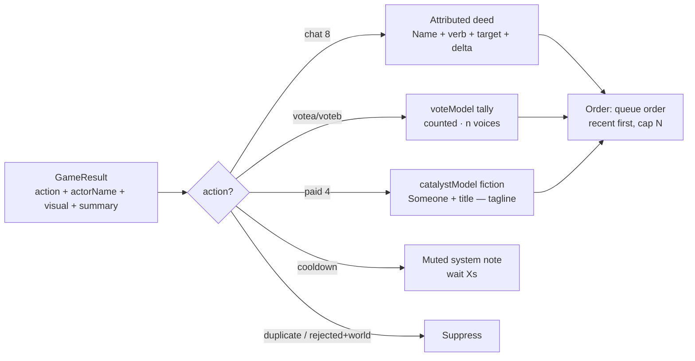

# T4A — Action Feed Spec (`Who → Did what → To what → What happened`)

> Design for a viewer-facing activity feed showing **all accepted viewer commands** with meaningful attribution and outcome. Uses actual event data + verified command semantics. No engine changes required. No code modified in this phase.

Privacy rule (hard): show display names + outcomes; **never** OAuth tokens, viewer account/channel IDs, private messages, arbitrary untrusted chat, amounts/payers, or internal ids/flags/counters/opcodes.

---

## 1. Attribution path (verified, both modes)

```
YouTube viewer
  → sidecar poll (adapter.mjs:335-411) → discover + liveChat.messages.list + cursor restart guard
  → mapper (mapper.mjs:40-158): leading-! token → {kind:chat_command, eventId:yt:<platformId>,
      actorId:yt:<channelId>, actorName:<displayName>, command:token.toLowerCase().slice(0,64),
      receivedAt:publishedAt, source:youtube, platformEventId}
      | paid → mapPaid (microsToMinor, ZERO_DECIMAL aware) | retraction → mapRetraction
      | else ignored (ordinary chat, memberships, polls, gifts never enter engine)
  → SSE fan-out (youtube-server.mjs:27-46,130-160, buf 200, heartbeat 25s, Last-Event-ID resume)
  → browser YouTubeSource (client.ts:117-190): canonical shape check (:36-55),
      engine-whitelist re-check (:168-170), vote siphon before ingest (:174-177, voteOptionIndex :30-34)
  → engine.ingest → queue (queue.ts:50-65: valid/dup/full; paid lane amount-desc, else FIFO)
  → pump (engine.ts:99-109: maxPerTick 4, minGap 100ms) → applyCommand/applyPaid (engine.ts:390-549)
  → GameResult {eventId, action, summary, actorName, actorId? (chat only), storyMessages[], visual{}}
      (types.ts:208-240) + onResult (app.ts:181-200) → feed.push + playResult + handleProcessedResult
  → presentation (hud.ts:44-197 / activity.ts) + Phaser visuals (GameScene.ts:232-271)

Simulation mode converges at engine.ingest: console reads #viewer-name/#viewer-id/#command
(app.ts:379-392,691-712) → same ingest → same queue/pump/apply/onResult/presentation.
Only provenance differs (source:simulation vs youtube).
Sidecar/transport never decide semantics; whitelist lives in engine/config.ts:12-24.
```

Key files: `src/engine/types.ts:5-56,208-252`, `config.ts:12-24,50-75`, `engine.ts:59-109,185-264,357-388,390-549`, `queue.ts`, `feed.ts`, `vote.ts:200-278`, `lifecycle.ts:187-243`, `runtime/progression.ts:513-547`, `youtube/client.ts`, `server/youtube/*`, `presentation/tidebound-presentation.ts`, `presentation/hud.ts`, `dashboard/activity.ts`.

---

## 2. What is available per accepted command (no engine change)

Whitelist: `!strike !mend !scout !shield !ring !hide !tribute !defy !votea !voteb !help` (`config.ts:12-24`) + 4 paid tiers (`paid_strike/supply/elite/story`, `config.ts:39-45`).

| Input | actorName | actorId | original vs normalized | target | outcome (`GameResult.action`) | numeric effect (`SIM`, `config.ts:60-75`) | time/order | rejection/cooldown |
|---|---|---|---|---|---|---|---|---|
| `!strike` | `actorName` (`types.ts:229`) | `actorId` (chat only, `:237`) — sim: console id; YT: `yt:<channelId>` | original raw **not stored**; stored `command=token.toLowerCase().slice(0,64)` (`engine.ts:65,72`, `mapper.mjs:74`) | current enemy | `attack` + `hitEnemy/shake/spawnWave?` | `-7` HP (`attackDamage`), `threat-1`; kill `+4` supplies (`+10` elite) | `receivedAt` (YT `publishedAt`, sim `now()`); FIFO normal lane; pump `4/100ms`; per-viewer `cooldown 3000` (`actorId:command`, `engine.ts:381-388`) | `cooldown` / `duplicate` / `rejected-invalid` / `dropped-full` |
| `!mend` | same | same | same | hero | `heal` + `healHero` | `+12` clamped, `heals++` | cooldown `5000` | same transport |
| `!scout` | same | same + meter key (`tidebound.ts:480-487`, one/stream/actor) | same | Pale / uniqueSearchers | `search` + `discovery=isNew` | `+20` progress, secret at 5; meter `pale-chart+1` only if ready | cooldown `10000` | `not-a-contribution/duplicate-contributor/meter-complete` → world unchanged, no extra result |
| `!shield` | same | same + meter key | same | keep | `shield` + `shieldKeep` | `keepShieldUntil=now+12000`, blocks 75%, `shields++`; meter `beacon-oil+1` only if cinder `strained/lost` | cooldown `8000` | same |
| `!ring` | same | same | same | threat | `ring` + `shake` | `threat+8`, `rings++` | cooldown `8000` | same |
| `!hide` | same | same | same | threat+resolve | `hide`, no visual | `threat-6`, `resolve-5` | cooldown `8000` | same |
| `!tribute` | same | same | same | `enemy.faction` (convention, `engine.ts:465-467`) | `tribute` or `rejected` | costs 5 supplies, `faction+5` | cooldown `10000` | `rejected` if `resources<5` or no faction — still a `GameResult`, still advances vote clock |
| `!defy` | same | same | same | `enemy.faction` | `defy` or `rejected` + `shake` | `faction-5`, `threat+4` | cooldown `5000` | `rejected` if no faction |
| `!votea/!voteb` | `actorName` on result; ballot keyed by `actorId` | sim console id; YT `yt:channelId` | normalized `!votea/!voteb` (display `!voteA/!voteB`) | active vote option 0/1 (`client.ts:30-34`) | **inert `rejected`** + `"<name>: the assembly has not been called."` (`engine.ts:492-498`) — no counters; ballot recorded via `castSessionVote` side-path before ingest | no state change; vote clock +1 per processed command (`lifecycle.ts:228-234`) | cooldown `5000` each | `vote-closed/no-active-vote` swallowed (sim `app.ts:384-388`, YT `app.ts:508-514`) |
| `!help` | same | same | same | none | `help` + command list | none | cooldown `2000` | — |
| paid 4 tiers | `actorName` on result; **`actorId` absent by design** (`types.ts:230-237` — paid attribution lives in ledger) | full `actorId/amount/currency` in `CanonicalPaidEvent` + `PaidLedgerAppliedEntry` | amount path (no command) | tier via `tiersFor/toTierUnits` (`config.ts:77-99`) | `paid_strike/supply/elite/story` + `visual{hitEnemy/shieldKeep/spawnElite+shake/majorStory+shake}` | strike `-15` enemy; supply `+30` supplies `+10` keep; elite `60+(wave+1)*25` HP threat+25; story `+20` supplies `threat+5` | paid lane first, amount-desc; ledger idempotency `findLedgerEntryByEventId → rejected duplicate` (`engine.ts:198-217`); `appliedAtIso/Stream`, checkpoint | `rejected-invalid` if `amount<=0`; `duplicate` ledger-applied/compensated; retraction-before-original → `applyCompensation` same pass |

Cooldown store: in-memory `Map<actorId:command>` (`engine.ts:43,381-388`), cleared on `loadWorld` — **not persisted**. Queue `seen` re-primed from ledger on load (`:162`) so paid idempotency survives, chat dedup does not (by design, ledger is paid-only).

**Verdict: every accepted command is representable without engine semantics change**, with two joins (see §3): vote ballots via `voteModel` tally (not `GameResult`), paid attribution via `paidLedger` join on `eventId` (today both correctly hidden publicly; feed uses fiction titles).

---

## 3. Event → display mapping (presenter joins, no engine change)

| `GameResult.action` | Who (display) | Did what (verb) | To what (target) | What happened (outcome + numeric prose) | Visual cue | Notes |
|---|---|---|---|---|---|---|
| `attack` | `actorName` | struck | Gloam Vessel (`world.enemy.name`) | `enemy HP x/y (−7)`; killed → `repelled · +4 supplies` | `hitEnemy/shake` | Example: `Kaushal struck the Gloam Vessel — enemy health decreased.` Numeric from `world.enemy` before/after or `SIM.attackDamage` constant (presenter-known) |
| `heal` | `actorName` | restored | Keeper's crew | `Keeper x/y (+12)` | `healHero` | Clamp note if at max |
| `search` | `actorName` | scouted | Pale Reaches | `charts n/5 (+1 if new)` | `discovery=isNew` | Duplicate scout → `already charted` (from `contributeForCommand` no-op reason) |
| `shield` | `actorName` | protected | lighthouse / beacon | `ward up 12s · Beacon Oil n/5` | `shieldKeep` | Dormant meter → `ward holds (oil dormant)` |
| `ring` | `actorName` | sounded | drowned bell | `threat n (+8)` | `shake` | Harm-signal styling (rose) |
| `hide` | `actorName` | doused | lantern | `threat n (−6) · resolve −5` | none | Trade-off styling |
| `tribute` | `actorName` | honored | faced faction | `standing +5 (cost 5 supplies)` or `rejected: need 5 supplies` | — | `rejected` still shows as feed entry (accepted command, failed effect) |
| `defy` | `actorName` | defied | faced faction | `standing −5 · threat +4` or `rejected: no faction` | `shake` | Same as tribute |
| `help` | `actorName` | asked | commands | `showed command list` | — | Low-priority; collapsible after burst (see §5) |
| `rejected` (vote-ballot path) | `actorName` | voted | assembly option A/B | `counted · total n voices` (from `voteModel` tally, not result) | — | `GameResult` is inert `rejected`; presenter keys off `voteMentioned(summary)` + `voteModel.ballots` (existing `activity.ts:89-92,122-127`) |
| `cooldown` | `actorName` | — | — | `wait Xs — ward rekindling` (remaining from `COMMANDS.cooldownMs`, presenter estimates; exact ms in-memory only) | — | Show as muted system entry, not as actor deed |
| `duplicate` | — | — | — | suppressed (never render; `queue.seen` replay) | — | Creator Activity may log; viewer feed drops |
| `paid_strike` | `Someone` (never payer) | called the storm | Gloam Vessel | `enemy HP −15` | `hitEnemy` | `catalystModel` fiction: `Gale Call — Someone called the storm…` (`tidebound-presentation.ts:370-379`); never amount/payer |
| `paid_supply` | `Someone` | sent | supply convoy | `+30 supplies · +10 keep` | `shieldKeep` | Fiction: `Supply Convoy` |
| `paid_elite` | `Someone` | drew | Herald's Attention | `elite vessel answers (HP …)` | `spawnElite+shake` | Fiction: `Herald's Attention` |
| `paid_story` | `Someone` | tolled | the Bell | `the tide turns (major)` | `majorStory+shake` | Fiction: `The Bell Tolls` |
| `rejected+world` (tick/ledger-dup/comp) | — | — | — | suppressed on viewer feed (`hud.ts:64-66` already drops) | — | Activity `ledger-note` over-merge is creator-only tech debt (see audit §4.7) |



Anonymous fallback: if `actorName` missing/blank → `A watcher` (never invent a name, never show `yt:<channelId>` or blank). Paid always `Someone` (never payer).

---

## 4. Feed item schema

```ts
interface ViewerFeedItem {
  id: string;            // GameResult.eventId (stable, dedupe key; paid: same; vote: result eventId)
  actor: string;         // display name or "A watcher" / "Someone" (paid); never actorId
  verb: string;          // struck | restored | scouted | protected | sounded | doused | honored | defied | voted | …
  target: string;        // Gloam Vessel | Keeper's crew | lighthouse | Pale Reaches | assembly option A | …
  outcome: string;       // enemy health decreased · Keeper +12 · ward up 12s · counted · …
  delta?: string;        // 46/60 (−7) | 34/40 (+12) | threat 62 (+8) — presenter-joined, prose-safe
  kind: "action" | "consequence" | "moment";  // classifyMoment(existing)
  action: GameResult["action"]; // machine signal (existing)
  at: number;            // receivedAt ms (YT publishedAt, sim now()); fallback: arrival order
  status: "applied" | "cooldown" | "rejected-effect"; // accepted command, effect may have failed
}
```

- `id` = `eventId` — replayed SSE (`Last-Event-ID`) or `queue.seen` replays dedupe naturally.
- `at` from `receivedAt` where present; `recentResults` carry no timestamps today (`activity.ts:7-9`) — presenter uses `receivedAt` from the ingested event where joined, else arrival index. No engine change (join in presenter).
- No `actorId`, `amount`, `currency`, `platformEventId`, `command` raw text, or internal flags — never in item, never in DOM attrs.

Rendering (landscape `364px` rail / portrait `1000px` stack):

```
[Name 18-20 bold] verb target — outcome (delta)
e.g. Kaushal struck the Gloam Vessel — enemy health decreased (46/60).
     ViewerTwo restored the Keeper's crew — Keeper 34/40 (+12).
     Someone called the storm — the Vessel reels (31/60).
```

---

## 5. Behavior rules

- **Ordering:** queue order (engine processing order), newest first. Cross-stream no global clock (same honesty as `activity.ts:27-28`); within-stream order is truth.
- **Max visible:** landscape 5, portrait 3 (fits height budgets; see layout specs). Overflow: collapse oldest into `+N more acts` (non-interactive on overlay; creator console links to Activity).
- **History retention:** viewer feed shows last N only (ephemeral, like `recent 30`); full history stays in creator Activity (`results 30 / story 40 / deeds 15 / ledger 200`). No persistence of feed beyond session.
- **Entry animation:** transform-only (`translateY 6px + fade 160ms`), `prefers-reduced-motion` → instant; batch announcements (`aria-live=polite`, one per 1.5s window = `batchWindowMs`), `aria-atomic=false`.
- **Bursts:** pump `4/100ms` + `batchWindowMs 1500` already coalesce (`feed.ts:22-39`, never merges `paid_story/elite`); viewer feed additionally collapses `>3 same-verb in window` into `Kaushal + 4 others struck the Vessel — enemy reels (…)` (presenter-only aggregation; engine untouched).
- **Duplicates:** `eventId` dedupe (SSE replay + `queue.seen`); `duplicate` results suppressed on viewer feed.
- **Missing identities:** blank → `A watcher`; paid → `Someone`; never `yt:<…>`, never empty, never invented names.
- **Rejected / cooldown:** accepted-command-with-failed-effect (`tribute` w/o supplies, `defy` w/o faction, vote when closed) renders muted (`wait Xs / need 5 supplies / assembly not called`); transport rejections (`rejected-invalid/dropped-full`, never results) surface only in creator diagnostics (`client.ts diag`, `activity.ts:1512-1524`), never viewer feed.
- **Long usernames:** 1-line ellipsis at ~18–22 chars (landscape) / ~24 (portrait); full name in `aria-label` + `title`; CJK/emoji safe (codepoint-aware, like `vote-announce.ts:46-48`); never break layout (`overflow-wrap:anywhere` as in `activity.ts:240`).
- **Mobile wrapping:** desc max 2 lines (`line-clamp:2`), kind chip `11–12px` never sole signal (verb text carries meaning); contrast on `rgba(10,6,24,.78+)` scrim.
- **Accessibility:** batch live region (not per-item), heading order preserved, non-color harm/help signals (rose `harm` verbs vs teal `aid` + text), keyboard N/A (overlay non-interactive), reduced-motion parity.
- **Anti-obscure:** feed is capped persistent HUD (not scrolling log); `max-height` + `overflow:hidden` (existing `css:96-97` pattern) guarantees gameplay stays open; event banner auto-dismisses; never modal.

---

## 6. What changes (T4D) vs what does not

- **No engine changes:** no new opcodes, no `GameResult` fields, no queue/vote/meter rule edits. All joins (`voteModel`, `catalystModel`, `world.*` HP, `COMMANDS.cooldownMs`, `receivedAt`) are presenter-side.
- **Presenter-only:** `renderOverlay` feed block (`hud.ts:64-81` today shows prose summaries) → attributed `ViewerFeedItem[]` builder + burst collapsing + muted cooldown/rejected-effect rows; DOM HP chips; event banner. Same projections, new arrangement.
- **Creator Activity stays:** full-fidelity log (`activity.ts`) unchanged; feed is the viewer-distilled surface.
- **Privacy preserved:** `pickLedgerFields` discipline (`activity.ts:387-411`) extended to feed (drop `actorId/amount/currency/platformEventId` by construction); queue waiting line `paid <amount>` (`app.ts:1499`) must be masked as part of T4D (one-line presenter fix, no engine change).

---

## 7. Acceptance examples (must all render)

- `Kaushal struck the Gloam Vessel — enemy health decreased (46/60).`
- `ViewerTwo restored the Keeper's crew — Keeper 34/40 (+12).`
- `ViewerThree protected the lighthouse — ward up 12s.`
- `ViewerFour scouted the Pale Reaches — charts 3/5.`
- `Someone called the storm — the Vessel reels (31/60).` (paid, no payer)
- `Rin voted — counted for the second path (12 voices).` (ballot via tally)
- `Ash honored the Ashen Choir — standing +5 (5 supplies offered).`
- `Ash honored the Ashen Choir — needs 5 supplies (muted).` (rejected-effect, still visible)
- `Kai sounded the bell — the Gloam presses (threat 70).` (harm-signal styling)

---

## 8. Risks / carryovers

- Numeric deltas are prose-joined today; presenter must read `world.*` before/after or `SIM` constants — brittle if tuning changes; T4D should centralize a presenter-side `deltaText(action, before, after)` map (no engine change, but must track `config.ts` tuning).
- Vote tally join needs `voteModel` snapshot at render time; late-joining viewers see totals, not their own ballot position (acceptable; ballots private).
- Cooldown remaining ms is in-memory only — feed shows `wait ~Xs` estimates from `COMMANDS.cooldownMs`, not live countdown.
- `!voteC` gap must resolve before Decide row + vote feed advertise third option.
- `recentResults` lack timestamps — `at` falls back to arrival order until presenter joins `receivedAt` (available on `CanonicalEvent`, not on result; join required).
