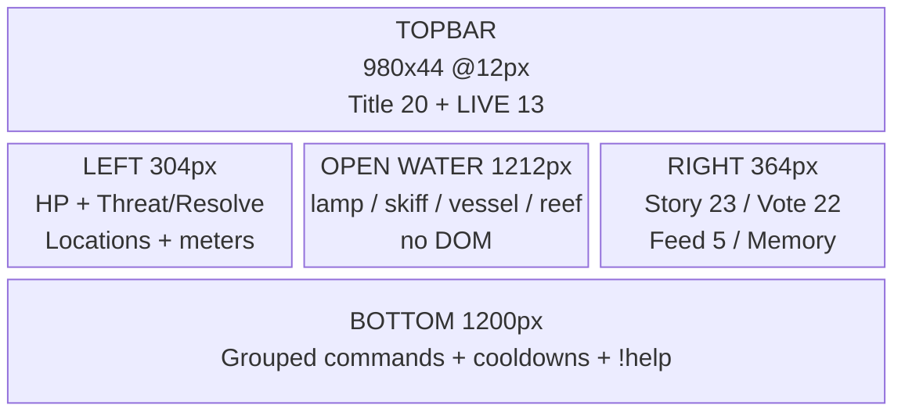

# T4A — Landscape 16:9 Layout Spec (1920×1080)

> Read-only audit + proposed layout. No code/CSS/Phaser modified. All current measurements are OBS output px at native `1920×1080` (`1 CSS px = 1 output px`; see §6 for 720p scaling). Preserve painterly diorama + existing Keeper/Vessel identity.

---

## 1. Current 1920×1080 occupation (as built)

Source: `overlay.html:9-14`, `src/presentation/hud.ts:44-197`, `src/presentation/tidebound.css:30-106`, `src/phaser/GameScene.ts`.

| Zone | Geometry (x, y, w×h) | Content | Notes |
|---|---|---|---|
| Topbar | x ~510–1410, y 12–~50, `max-width:900` centered (`css:47-58`) | `Tidebound 18px · ARC/CHAPTER 13px · STREAM 11px pill` | Quiet, `nowrap`; no LIVE |
| Left rail | x 20–292 (w 272), y 120→~620+ (`css:79-87`) | World state (Threat/Resolve 15px + 8px bars, Supplies, locations 14px) + 2 meters (14/12/13px) | Height content-dependent; translucent `rgba(10,6,24,.6)` + `pointer-events:none` |
| Right rail | x 1548–1900 (w 352), y 120–944 (`max-height:824 overflow:hidden`, `css:88-98`) | Story 23/14px → vex 16px → vote 21/16/15/14/16px → feed 14px → deeds/recap 13px | Tallest; clips by design when vote open + vex + 3+3+recap (`hud.ts:88-98` comment) |
| Bottom strip | x ~410–1510, y ~980–1068, `max-width:1100` centered (`css:99-106`) | 3 cmd groups 13px (label 11px, `min-width:64px`) + help 12px | 2–4 wrapped rows; `white-space:nowrap` per group |
| Paused badge | x centered, y 104 (`css:224-228`) | `PAUSED` 16px gold pill | Only when paused |
| Open water | x 292–1548 (1256px), y ~50–980 | Canvas entities (see §2) | Fully readable; rails translucent |
| Canvas bars | Keep `x205 y592 w190`, hero `x628 y926 w184`, vessel `x1280 y566 w200` (`GameScene.ts:190-199`), `h20` | `Keep/Keeper/hp` 22px, labels 24–26px | Keep bar touches left-rail edge (x205 vs rail to 292) — partial underlap, legible via translucency |

World anchors (world coords = screen coords, `cameras.main.setBounds(0,0,1920,1080)` only, no zoom/scroll — `GameScene.ts:139`):

- Sky `0–660`, sea `660–1080` (`HORIZON=660`, `:19-21`).
- Cinderholm keep `x120–320 y410–770` (tower `245,430 110×260`, lamp `300,392`, beam `350,380→1150,300/484`); island `120,640 200×130`.
- Keeper skiff container `720,800` (hull `610–830/838–895`, lantern `778,760`); hero bar `628,926`.
- Reef posts `x ~850–1250 y884/850`, label `y962`.
- Vessel container `1420,780` (`210×84` + masts/sails to `y~570`), bar `1280,566`, labels `1420,630/660`.
- Chapel steps `470–560/726–800`, flame `525,706`.
- Moon `1560,175 r46`, clouds/storm bands upper sky.

Focal points: lamp/beam center-left, skiff mid-water, vessel right-mid, reef mid-lower. Beam sweeps under right rail (`alpha .07–.24`) as intentional backdrop.

Overlaps: only keep bar/label vs left rail (~87px underlap); vessel clear of right rail by ~68px; reef label tight above bottom strip (`y962` vs strip `~980+`).

---

## 2. Safe areas + OBS requirements

- OBS Browser Source: `1920×1080`, transparent (no extra styling) — `settings.ts:162-164`, `index.html:639`, `overlay.html:9-14` (`background:transparent`).
- Current safe margins hold at 1920×1080 by construction (`css:28`); rails `20px` from edges, topbar `12px`, bottom `12px`.
- Proposed safe areas (stream chrome + TV overscan):
  - Action-safe: 40px inset on all sides (no critical text outside `40–1880 × 40–1040`).
  - Title-safe: 80px inset for headline/vote prompt (`80–1840 × 80–1000`).
  - Bottom strip must clear platform player chrome: keep `bottom:12px` only for OBS source (no player chrome in OBS); for simulcast preview in browser, add 24px clearance note.
- Transparency: root adds no background (`hud.ts:1-5`, `css:30-36`); panels `rgba(10,6,24,.6-.78)` + border + shadow — keep; never opaque full-bleed.
- No overlay media queries today (`tidebound.css:260-263` only affects creator console) — landscape spec stays fixed-px; responsiveness is documented as scale math (§6), not CSS breakpoints.

---

## 3. Proposed landscape layout (preserve identity, fix gaps)

Keep: full-bleed diorama; left world rail; right story rail; centered topbar/bottom strip; gold `L1 story` emphasis; `pointer-events:none` HUD.

Change (presentation only, no engine):

```
┌──────────────────────────────────────────────────────────────┐
│ [12px]        TIDEBOUND · LIVE · ARC I · CHAPTER I · STREAM n │  y12-56, centered, max-w 980
│                                                              │
│ Left 304px            OPEN WATER 1216px            Right 384px│
│ x20-324 y120-...      x324-1540 y56-968           x1536-1920  │
│ World state           Canvas focus                Story now   │
│ Keeper/Light/Vessel   lamp/beam/skiff/vessel      Vote (when │
│ HP (NEW numeric DOM)  reef/chapel/moon             open → L2) │
│ Threat/Resolve/Supply                               Feed (5)  │
│ Locations+meters                                   Memory    │
│                                                              │
│ [bottom 16px]  Act / Explore / Decide + cooldowns + !help     │  centered, max-w 1200
└──────────────────────────────────────────────────────────────┘
```

### Region dimensions (output px @1920×1080)

| Region | Geometry | Typography (output px) | Content |
|---|---|---|---|
| Topbar | `x470–1450 (w980), y12 h44`, centered, `padding:6 20`, pill | Title 20 bold 0.24em gold; `· LIVE` 13 bold red-dot + gold; sub `ARC/CHAPTER 13, STREAM 11` | `TIDEBOUND · ● LIVE · ARC I · CHAPTER I · STREAM n`. LIVE dot CSS-only pulse (disabled under `prefers-reduced-motion`). Saga omitted (keep quiet) or as `title` attr |
| Left rail | `x20 w304 (20–324), y120, gap:10` | Stat 16, loc 14, meter row 14 / status 12 / hint 13, HP line 16 tabular | World state + **NEW `Keeper 34/40 · Keep 28/30 · Vessel 46/60` single line** (from existing `world.*`, no engine change) + Threat/Resolve/Supplies + locations + 2 meters. Bars 8px unchanged |
| Right rail | `x1536 w364 (1536–1900), y120, max-h:800, overflow:hidden, gap:10` | Moment 23/1.32, Next 14, prompt 21/1.3, opt 16/key 14/cmd 15/n 16, tally 14, verdict 16, feed name 18→desc 16 (see feed spec), deed/recap 13, vex 16 | Story → vex (temp) → vote → **action feed (5 entries, ~5×44px)** → deeds (2, was 3) → recap (1 + place/tension). Reduce deeds to 2 to fund feed height within 800px |
| Bottom strip | `x360–1560 (w1200), y~972–1068 (bottom:12), padding:10 18` | Group 14, label 11, cmd 14 teal bold, help 13 | `Act: !strike Strike … (3s) … / Explore: … / Decide: !voteA/B …` + `New here? Type !help · votes count only while assembly calls one`. Cooldowns from `COMMANDS.cooldownMs` (presentation-only) |
| Event banner (NEW, temporary) | `x560–1360 (w800), y70–~120`, centered below topbar | Title 20 bold + sub 15 | `Herald's Attention — an elite vessel answers` / `Assembly opened/closed` / `majorStory`. 4–6s, `aria-live=assertive` once, transform-only entry, never duplicates feed/vote verdict |
| Paused | Centered `y104` | 16 bold | Unchanged |

Height budget (right rail, `max-h:800`): story ~120 + vex 0/48 + vote dormant 48 / open ~260 / closed ~140 + feed 5×44=220 + deeds 2×22=44 + recap ~70 + gaps 40 ≈ 550–740px. Fits 800px in all vote phases; no clip at 1080p. At 720p (0.667×) the rail is `243px` wide — text wraps, height grows; allow rail scroll-hidden (already) and reduce feed to 4 on `≤720p` via OBS-side note (no CSS breakpoint needed; document as operator guidance).

### Information hierarchy (landscape)

1. Story now (L1, gold left border, strongest).
2. Assembly vote **when open** (L2, gold border promotion — already `css:143`; add `open` glow only, no color-glow excess).
3. Action feed (L3, persistent 5).
4. World/HP/meters (L4 left).
5. Memory/vex/commands (L5/L2b quiet; vex temporary).

Dedup: verdict once (vote card); feed never repeats verdict text; deeds once; event banner never persists.

---

## 4. Typography scale (landscape output px)

| Token | Current | Proposed (1080p output) | 720p effective | Note |
|---|---|---|---|---|
| Title | 18 | **20** | 13.3 | +LIVE 13 |
| Story moment | 23 | **23 (keep)** | 15.3 | Strongest; max 2 lines, ellipsis |
| Story next | 14 | **14 (keep)** | 9.3 | Gold; 1 line |
| Vote prompt | 21 | **22** | 14.7 | Max 2 lines |
| Vote opt / cmd / n | 16/15/16 | **16/15/16 (keep)** | 10.7/10/10.7 | Borderline at 720p — accept (headline carries meaning) |
| Vote tally/verdict | 14/16 | **14/16 (keep)** | 9.3/10.7 | Verdict bold gold winner |
| Feed name / desc | — (14 prose) | **18 bold / 16** (see feed spec) | 12/10.7 | Names tabular, 1 line ellipsis |
| Health labels | canvas 22 | **DOM 16 tabular** (new) | 10.7 | Canvas bars keep 22 (world-anchored) |
| Cmd group / help | 13/12 | **14 / 13** | 9.3/8.7 | Help still quiet but ≥13 |
| Kicker / lead / stream | 11 | **11 (keep, decorative only)** | 7.3 | Never sole signal |

Line-length: right rail `364px` → ~38–44 chars at 16px; feed desc wraps max 2 lines; usernames ellipsis at ~18 chars (see feed spec).

---

## 5. Mermaid — landscape composition



---

## 6. Responsive / scaling rules (landscape family)

- Native `1920×1080`: 1:1 as authored.
- `1280×720` (same source, OBS scales `0.667×`): headline/prompt/verdict hold; choice rows tall enough (28px key → 18.7px); 11px kickers (~7.3px) decorative-only — acceptable. Operator guidance: prefer 1080p source; if 720p, reduce feed to 4 and deeds to 1 (documented, no code branch needed for T4A).
- CSS px = OBS output px **only** at native source size. At any other canvas size, `effective = CSSpx × outputWidth/1920`. State this in OBS setup doc (T4E); do not equate silently.
- No CSS breakpoints for overlay in T4A; all landscape responsiveness is whole-bitmap scaling. Dedicated portrait uses separate composition (vertical spec), not scaling.

---

## 7. Accessibility (landscape)

- Keep: `aria-live=polite` story + active vote; `progressbar` clock/meters; non-color signals (`●/◐/○`, `Leading`, `✦`); DOM story-first order; `pointer-events:none`; reduced-motion kill (`css:241-243` + `GameScene.reducedMotion`).
- Add with feed: batch `aria-live` (one announcement per 1.5s window, not per item); event banner `assertive` once then `polite`; feed names never truncated for AT (full name in `aria-label`, visual ellipsis only); contrast re-check at 14px dim on translucent panel (keep `#b9b3c7` on `rgba(10,6,24,.78)` — passes for large/secondary text; do not drop panel opacity below `.6`).

---

## 8. Performance

- `innerHTML` rewrite per tick is retained; feed cap 5 keeps DOM ~40 nodes; transform-only entry (`translateY 6px + fade 160ms`) avoids layout thrash; `content-visibility:auto` on memory panels.
- No second `Phaser.Game`; no new textures; burst/shake budgets unchanged.

---

## 9. Risks / carryovers

- Right-rail `overflow:hidden` still clips pathological stacks (vote open + vex + 5 feed + banner) — mitigated by deed reduction + `max-h:800`; residual clip is by design (gameplay stays open).
- Keep-bar underlap persists (x205 vs rail 20–324) — accept (translucency) or nudge keep bar to `x330` in T4C (Phaser change, owner approval needed; not in T4A).
- `!voteC` gap must resolve before feed shows vote commands (else feed advertises an unmapped command).
- 720p small-label legibility is guidance-only in T4A; T4F regression must verify at viewing distance.

---

## 10. T4B gate (landscape)

Owner signs: region map (§3), type scale (§4), LIVE lockup, HP DOM line wording, event-banner copy, 720p operator guidance. Then T4C/T4D implement.
