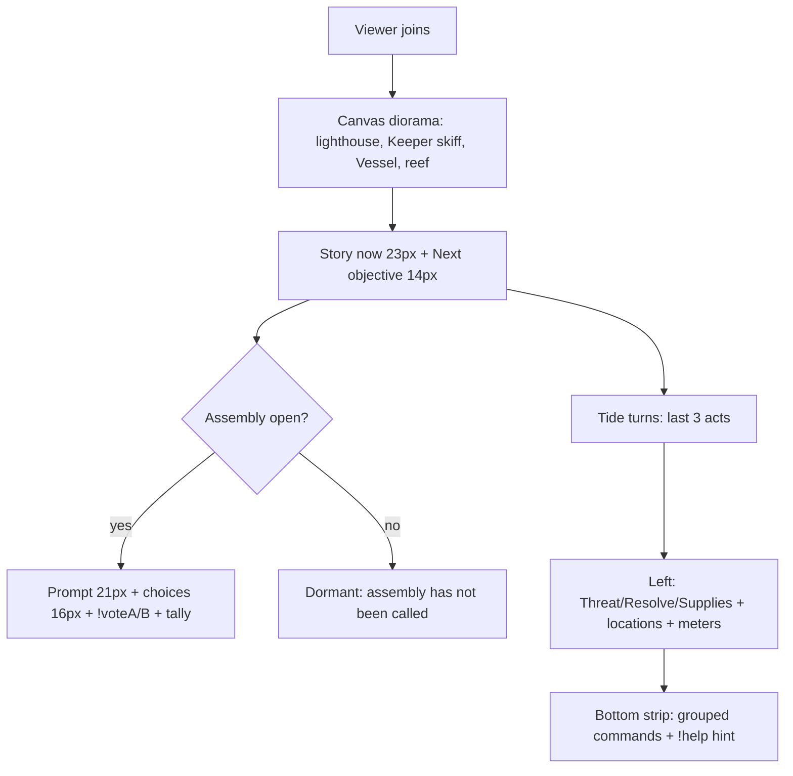

# T4A — Viewer Experience Audit (Current State, Read-Only)

> Status: research / inspection / design documentation only. No game code, engine, Phaser, CSS, HTML, config, or artwork was modified for this audit. All findings cite implementation as observed on branch `main` (ahead 1, uncommitted work preserved — see §12).

Related specs:

- `docs/t4a-landscape-layout-spec.md` — 16:9 region map + OBS rules
- `docs/t4a-vertical-layout-spec.md` — 9:16 reframe + camera strategy
- `docs/t4a-action-feed-spec.md` — attribution path + `Who → Did what → To what → What happened` feed
- Approved T4 direction: both 16:9 + 9:16; show **all accepted viewer commands** in the activity feed; **reframe** (not crop) portrait.

---

## 1. What was inspected

| Surface | File | What it proves |
|---|---|---|
| Overlay shell | `overlay.html:9-14` | Fixed `1920×1080` stage, `#game` + `#hud` absolute `inset:0`, canvas forced `1920×1080 !important`, transparent background |
| Overlay entry | `src/overlay.ts:1-5` | `createRuntime({withPanel:false})`, never writes persistence (`src/app.ts:287`) |
| Overlay HUD | `src/presentation/hud.ts:44-197` | Read-only projection, DOM order story-first, visual order absolute CSS |
| Overlay tokens/layout | `src/presentation/tidebound.css:1-243` | Hierarchy L1 story → L2 vote → L3 meters/feed → L4 memory → L2b commands; fixed rails |
| Presentation projections | `src/presentation/tidebound-presentation.ts` | `headerModel`, `threatModel`, `voteModel`, `catalystModel`, `commandGuide`, `Never "LIVE"` (`:457`) |
| Phaser diorama | `src/phaser/GameScene.ts:19-21,139,154-228,232-280,282-660` | `W=1920 H=1080 HORIZON=660`, `setBounds(0,0,W,H)` only, no zoom/scroll/follow; state-driven `syncWorld` + `playResult` |
| Creator console | `index.html` (full) + `src/app.ts`, `src/dashboard/*` | Control Room / Activity / Settings; T3 announcement composer wiring |
| Engine | `src/engine/config.ts`, `types.ts`, `engine.ts`, `queue.ts`, `vote.ts`, `lifecycle.ts`, `feed.ts` | 11 canonical commands, queue/retention, vote/meter rules |
| YouTube path | `server/youtube/*.mjs`, `server/youtube-server.mjs`, `src/youtube/client.ts` | Sidecar mapping → SSE → browser ingestion; no gameplay in sidecar |
| Vote announcements | `src/presentation/vote-announce.ts`, `src/app.ts:103-138,542-672,1020-1076` | Pure composer + per-vote delivery state machine |

Sub-agent traces (read-only) were used to cross-check HUD, attribution, and vote/typography claims against source lines; this document re-verified the load-bearing lines directly.

---

## 2. First-time viewer walkthrough (what joining the stream feels like)

Assumes OBS Browser Source pointed at `/overlay.html` at `1920×1080` (per `src/dashboard/settings.ts:162-164`, `index.html:639`).

1. **World backdrop (canvas):** drowned-archipelago diorama — sky/stars/moon (`GameScene.ts:284-333`), sea (`:340-344`), Cinderholm keep + lighthouse tower/lamp/beam (`:383-409`), Keeper skiff (`:542-563`), Pale reef lanterns (`:590-598`), Gloam Vessel hull/masts/sails (`:603-637`), Chapel brazier (`:644-649`). Threat drives weather: `chop = 0.35 + threat/100*0.9`, sky/moon tint (`:154-168`).
2. **Eyebrow (`tb-topbar`, `hud.ts:151-156`, `tidebound.css:47-77`):** `Tidebound · ARC I · CHAPTER I · STREAM n`. Centered `top:12px`, `max-width:900px`, `nowrap`. Quiet by design (level 4).
3. **Story now (`tb-story`, `hud.ts:159-163`, `css:116-121`):** kicker `Story now · ACTION/CONSEQUENCE/MOMENT` + `storyLog[0]` (23px) + `Next · <objectiveModel>` (14px gold, left gold border). Strongest surface.
4. **Vex banner (conditional, `hud.ts:164`):** `Vex driven off / raids / elite herald / watches` or hidden when quiet (`tidebound-presentation.ts:393-408`). 16px rose, red border.
5. **Assembly vote (`tb-vote`, `hud.ts:112-135`):** dormant (`The assembly has not been called…`), open (prompt 21px + A/B/C + `Leading` + `!voteX` + counts + command-clock + `N voice(s) · closes after M (K left)`), or closed (`The assembly chose X` / `No winner…`). `role=status aria-live=polite` when active.
6. **Tide turns (`tb-feed`, `hud.ts:166-169`):** kicker + up to 3 `recent[]` items or `feed[]` fallback or `Awaiting the first act…`. 14px + 11px kind chip.
7. **World remembers + Recap (`hud.ts:170-178`):** up to 3 deeds (13px, `✦`) + up to 2 recap lines + place/tension line (13px, `max-height:88px`).
8. **World state left (`tb-left`, `hud.ts:180-191`):** Threat `/100` + 8px bar, Resolve + bar, `◆ Supplies N`, per-location `●/◐/○ NAME — CONDITION · note`, plus two meters (`Charting the Pale`, `Beacon Oil`, 8px bars).
9. **Command strip (`tb-bottom`, `hud.ts:193-195`):** grouped `Act: !strike !mend !shield !tribute !defy / Explore: !scout !ring !hide / Decide: !voteA !voteB` + `New here? Type !help…`. Single compact strip, `bottom:12px`, `max-width:1100px`.



---

## 3. Can the viewer answer the ten questions?

| Question | Answerable? | Where / gap |
|---|---|---|
| What is Tidebound? | **Partial** | Title `Tidebound` shown; saga `The Cantor's Siege` modeled (`headerModel().saga`) but **never rendered** (`hud.ts:151-156`). No one-line premise on overlay. |
| Current story situation? | **Yes, thin** | `storyLog[0]` + `Next` objective (5 branches, `tidebound-presentation.ts:147-165`). Good for now; no arc recap beyond 2 recap lines. |
| Who is the Keeper? | **Partial** | `KEEPER'S SKIFF` + `Keeper hp/max` + skiff sprite/primitives + `WARD UP` (`GameScene.ts:415-419,547-563`). No name/role line; `Rho/Ilya` appear only in rites/vote labels (creator surface). |
| What threatens the lighthouse? | **Yes** | Gloam Vessel name/`ELITE·name`/`hp` or `REPELLED` (`GameScene.ts:198-204,630-637`) + threat bar/sentence + Vex banner. Threat→weather tint reinforces. |
| Current objective? | **Yes** | `objectiveModel` gold `Next · …` line. |
| What is the community deciding? | **Yes when open / weak when dormant** | Open vote card is complete; dormant card is one line; closed card shows winner + reason. No countdown beyond command-clock. |
| How to participate? | **Yes, compact** | Bottom strip groups 10 commands + `!help` hint. `!tribute/!defy` faction semantics (`Spend supplies…/Provoke…`) are terse; `!ring/!hide` trade-offs unexplained on overlay. |
| Was my command accepted? | **No (gap)** | Overlay shows last 3 `recent[]` summaries (`hud.ts:64-73`) but **no per-viewer attribution** (no display names). A viewer cannot find their own `!strike` among merged prose. Rejections/cooldowns never surface on overlay. |
| What happened as a result? | **Partial** | `summary` prose + canvas burst/shake/flash/spawn (`GameScene.ts:232-271`). Numeric deltas (`-7 HP`, `+12`) live only inside prose, not as structured fields. |
| Did I help or harm? | **Partial** | `classifyMoment` kinds (`ACTION/CONSEQUENCE/MOMENT`, `tidebound-presentation.ts:337-359`) + kind chips + threat tone sentence. No explicit helped/harmed badge. |

**Functional gaps (not just visual):**

1. No viewer identity on overlay — accepted-command attribution missing end-to-end on the viewer surface (engine has it; overlay drops it — see `t4a-action-feed-spec.md`).
2. No rejected/cooldown signal on overlay (`cooldown`/`rejected` are `GameResult`s but filtered or prose-only; `hud.ts:64-66` drops `rejected+world`, queue rejections never become results).
3. `!voteC` advertised for Kindling (`VOTE_COMMANDS` includes `!voteC`, `tidebound-presentation.ts:208`) but engine whitelist has only `!votea/!voteb` (`config.ts:21-22`), YouTube mapper only `!votea/!voteb` (`client.ts:30-34`), rehearsal `<select>` only `!voteA/!voteB` (`index.html:593-605`). Third option has no chat path — viewers typing displayed `!voteC` get `rejected: the assembly has not been called` (`engine.ts:492-498`).
4. No `LIVE` pill by design (`tidebound-presentation.ts:457`); `STREAM n` + `PAUSED` only. YouTube connection state never reaches overlay (console-only, `app.ts:1117-1141`). First-time viewers get no stream-liveness confirmation from the overlay itself.
5. No numeric-effect channel: `GameResult` has no delta fields; everything numeric is inside `summary` prose (`types.ts:208-240`). Any future feed tally must parse prose or join projections.
6. No portrait support: fixed `1920×1080` CSS, no overlay media queries (see vertical spec).

**Visual-design (non-functional) improvements:**

- Saga line omitted; Keeper/lighthouse lack one-line identity; `!tribute/!defy/!ring/!hide` hints too terse; 11–13px kickers/help fall below stream legibility at 720p (see §8); right rail can clip under `max-height:824px overflow:hidden` (`tidebound.css:96-97`) when vote + vex + 3 feed + 3 deeds + recap stack.

---

## 4. Visual hierarchy (existing → recommended)

Existing CSS hierarchy comment (`tidebound.css:1-6`): `1 story moment · 2 assembly vote (when called) · 3 action→consequence · 4 world state · 5 memory`.

| Priority | Element | Current size | Keep / change (T4B) |
|---|---|---|---|
| 0 | Stream identity + LIVE | `STREAM n` 11px pill, no LIVE | **Add** `TIDEBOUND · LIVE` lockup; keep `ARC/CHAPTER/STREAM` as quiet subline (see landscape spec) |
| 1 | Story situation | Moment 23px `#fff3d6`, Next 14px gold | Keep as strongest surface; add one-line premise on first join (T4B copy, not engine) |
| 2 | Keeper + lighthouse + Vessel + health | Canvas labels 20–26px + 20px bars; DOM threat/resolve 15px + 8px bars | Keep canvas anchors; **add DOM numeric HP line** sourced from existing `world.keepHp/heroHp/enemy` (no engine change) |
| 2b | Assembly vote (when open) | Prompt 21px, opt 16px, cmd 15px, tally 14px, verdict 16px | Keep; promote to strongest temporary focal point (gold border already, `css:143`); fix `!voteC` path or remove third-option display |
| 3 | Recent viewer actions | Feed item 14px, kind 11px; 3 items | **Replace with attributed action feed** (see feed spec); feed becomes persistent HUD, not fallback prose |
| 3b | Participation instructions | Group 13px, label 11px, help 12px | Keep grouped strip; raise help to ≥13px; add cooldown hint (`3s/5s…`) from existing `COMMANDS.cooldownMs` |
| 4 | World state / meters | Stat 15px, loc 14px, meter 14px/hint 13px | Keep left rail; collapse to icons + numbers on small/portrait |
| 5 | Memory (deeds/recap/vex) | Deed/recap 13px, vex 16px | Keep as quiet persistent; vex stays temporary announcement |
| Announce | Narrative events (elite spawn, driven-off, story beat) | Canvas flash/shake/burst + story line | **Add temporary event banner** (4–6s, `aria-live=assertive` once) sourced from existing `visual.*` + `storyMessages`; no engine change |

Persistent vs temporary:

- Persistent: title/LIVE, story now + objective, Keeper/lighthouse/Vessel/health, world state/meters, vote card (dormant/open/closed), action feed (last N), command strip.
- Temporary (auto-dismiss, reduced-motion safe): Vex banner state changes, elite/wave spawn, `majorStory` beat, vote opened/closing-soon/closed, announcement delivery is **creator-only** (never viewer).

Dedup rules: story line never repeats feed line verbatim; vote verdict appears once (vote card), not also as feed item; deeds appear once (memory), not re-announced.

---

## 5. Typography / mobile readability audit (actual px)

All overlay sizes are `1 CSS px = 1 OBS px` at native `1920×1080` (`overlay.html:12` forces canvas `1920px !important`; rails fixed px; no overlay media queries). Creator console uses `Phaser.Scale.FIT` and scales down (`app.ts:243-251`, `index.html:52-53`) — **not** 1:1 there.

| Element | Selector | px |
|---|---|---|
| World title | `.tb-world` `css:59-65` | 18 bold, 0.24em |
| Arc / chapter | `.tb-arc/.tb-chapter` `css:66-67` | 13 |
| Stream pill | `.tb-stream` `css:68-77` | 11 |
| Story moment | `.tb-moment` `css:119` | 23 / 1.32 |
| Story next | `.tb-next` `css:120` | 14 |
| Vote prompt | `.tb-prompt` `css:148` | 21 bold |
| Vote opt / key / cmd / count | `.tb-opt/css:149-174` | 16 / 14 (28px box) / 15 teal / 16 tabular |
| Vote tally / soon / verdict | `css:187-194` | 14 dim / 13 rose bold / 16 |
| Feed item / kind | `css:209-210` | 14 / 11 |
| Deed / recap | `css:217-219` | 13 / 13 (88px cap) |
| Vex / paused | `css:222-228` | 16 bold |
| Cmd group / label / help | `css:233-237` | 13 / 11 / 12 faint |
| Canvas labels | `GameScene.ts:415-429,566-573,595-598,630-637,653-656` | 26 keep/vessel, 24 ward/skiff, 22 HP/reef, 20 chapel; bars `190/184/200×20` (`:667-680`) |

Scale math (OBS scales whole `1920×1080` bitmap linearly; `effective = CSSpx × outputWidth/1920`):

| Output | Scale | Effective (CSS→out) | Verdict |
|---|---|---|---|
| `1920×1080` landscape | 1.00× | 23, 21, 16, 14, 13, 11 as authored | Readable; 11–12px kickers intentionally quiet |
| `1280×720` landscape | 0.667× | 23→15.3, 21→14, 16→10.7, 14→9.3, 13→8.7, 11→7.3; canvas 26→17.3/22→14.7/20→13.3 | Headline/prompt/verdict hold; choice rows/counts borderline; 11px `Leading`/labels + 12px help fall below comfortable legibility |
| `1080×1920` portrait (fit-width) | 0.5625× pillarboxed `1080×608` | 23→12.9, 21→11.8, 16→9, 14→7.9 | **Not viable** — landscape rails at 0.56× + pillarbox; needs dedicated portrait layout, not scaling |
| `720×1280` portrait | 0.375× fit-width | 23→8.6, 21→7.9, 16→6 | Illegible without reframe |

Proposed minimums (output px, not CSS px — specify both in layout specs):

- Main title 28–32 (landscape) / 34–40 (portrait); story headline 28–32 / 32–38; vote prompt 26–30 / 30–36; vote choices 20–22 / 22–26; vote totals 18–20; action names 18–20; action descriptions 16–18; health labels 16–18; command instructions 16–18. All ≥16 output px for body, ≥11 only for decorative kickers. Rationale: 720p landscape (`0.667×`) and mobile portrait viewing distance.

---

## 6. Voting + command experience audit

Vote descriptors: `ROUTE_VOTE` (2 opts, `maxCommands:25`), `KINDLING_VOTE` (3 opts, `maxCommands:30`) (`content/tidebound.ts:406-416`); `MANUAL_RITES` exclude vote templates (`:424-430`).

Lifecycle (`engine/vote.ts`, `lifecycle.ts`, `runtime/progression.ts`):

- Open: `openVote` (2–3 distinct opts, `maxCommands>0`, `:132-192`); `openSessionVote` rejects if running (`lifecycle.ts:187-204`); dashboard mirrors gating (`control.ts:70-97`).
- Ballots: `actorId→idx`, latest-wins (`vote.ts:200-227`); T3 tests `vote-meter.test.ts:246-291`).
- Clock: `+1` per processed **relevant chat command**, never paid (`vote.ts:240-249`, `lifecycle.ts:228-234`, `progression.ts:469-486`); `closingSoon = maxCommands-commands ≤5` (`tidebound-presentation.ts:261`).
- Tally: distinct-voter counts (`vote.ts:271-278`); projection adds `totalBallots/clockProgress/closingSoon` (`:220-266`).
- Close: manual idempotent (`vote.ts:251-259`); auto-close fires exactly once (`progression.ts:240-260`, `app.ts:189-198`); stream-close abandons open vote, next stream clean (`progression.ts:400-416`).
- Resolve: highest wins; persistent ties → lowest index; no-ballots/ineligible → `winner:null`, never runner-up, never mutates (`vote.ts:300-331`); `resolveAndFireVote` no-op on null/failure (`progression.ts:197-231`); override records keeper deed, ballots untouched, vote closes (`vote.ts:340-366`, `progression.ts:298-338`).

T3 announcement composer (pure, `vote-announce.ts`): `ANNOUNCE_MAX_CHARS=200` (`:16`), `composeVoteOpen/Result` (`:67-109`), identity `vote:<safeSession>:<vote>:open|close` (`:123-129`), `isValidEventId` (`:132-134`). Delivery states `na-simulation/sending/sent/failed/uncertain/not-connected/reauth-required` (`:140-167`); per-vote record in-memory (`app.ts:103-109`); `postAnnouncement` + `applySendResult` (`:565-602`); open skips on sim (`:604-628`), close only on genuine open→closed (`:636-659`), retry reuses text+identity (`:661-672`); failure never rolls back game vote (`:542-547`).

Required overlay communication:

| State | Viewer sees (game truth) | Creator sees (Control Room) | Must not leak |
|---|---|---|---|
| Vote opened | `Assembly · open` + prompt + A/B(/C) + `!voteA/B(/C)` + counts + clock + `N voice(s)` | Engine vote + `Chat announcement (open): <status>` + preview/retry | API errors, tokens, `liveChatId`, amounts — creator console only (`yt-detail`, `app.ts:1137-1140`), never overlay/SSE |
| Live tally | Counts + `Leading` + clock + `closing soon` (≤5) | Same + availability gating | Per-actor ballots (latest-wins map) stay private |
| Vote closing | `closing soon` + clock almost full | Next-action priority surfaces queue/YT/pause before vote-closing (`overview.ts:54-63`) — vote may close while operator follows higher banner (accepted risk, document) | — |
| Result / tie / no-winner | `The assembly chose X (reason)` / `No winner — the tide stays its course (reason)` | Same verdict + `Chat announcement (result): <status>` + retry | Delivery status never mixed into viewer verdict (`hud.ts` renders no delivery) |
| Delivery failure | **Nothing** (viewer sees game truth only) | `Failed / uncertain / not-connected / reauth-required — retry below`; sim shows `Chat preview (not sent)` (`app.ts:1050-1067`); read-vs-post guidance (`settings.ts:87-99`) | Internal `quota/rate/ended/auth` mapped to typed errors (`youtube-outbound.test.ts`); raw bodies never shown |

Conflation risks (observed, carry to T4B):

1. Engine phase + delivery share one `#cc-vote` card (`app.ts:1043-1071`) — quick scan can misread `decided` as `announced`. Mitigated today by separate lines + `never says announced unless confirmed` comment (`:1043-1045`).
2. One `closeEventId` for manual/auto/override + first-`sent`-wins skip (`vote-announce.ts:118-129`) — second close looks like dropped message; actually idempotence.
3. `Overview/Activity` mirror game truth with **no delivery suffix** (`overview.ts:281-292`, `activity.ts:204-222`) — good for viewers, but creator must visit Control Room to see missing chat message.
4. Past votes exist only as text mentions (`activity.ts:18-24`); failed close leaves no timeline entry pointing at missing chat message (announce record is in-memory, `app.ts:103-109`).
5. `!voteC` stall (see §3.3) surfaces only as `vote-mention` ballot-note, never warning (`activity.ts:102-132`).

---

## 7. Accessibility (as built)

- `#stage role=img`, `#hud aria-live=polite` (`overlay.html:17-19`); `.tb-hud aria-label` (`hud.ts:150`); story + active vote `role=status aria-live=polite`; vote clock/meters `role=progressbar` with labels/values; vex `role=status`.
- State never color-alone: locations `●/◐/○` + uppercase text (`hud.ts:188`); threat tone + sentence (`threatModel` + `hud.ts:183-186`); vote `Leading` tag + `◆/◇` + bold; deeds `✦`.
- Contrast: ink `#f4efe4`/dim `#b9b3c7`/gold `#ffd166` on `rgba(10,6,24,.6-.78)` + border/shadow (`css:8-22,38-43`); canvas labels high-contrast on dark sea. Faint `#8d89a0` help-only.
- Reduced motion: HUD kills animation/transition (`css:241-243`); scene skips waves/clouds/tweens/particles, freezes Keeper to frame 0 (`GameScene.ts:98-101,142-150,318-320,410-412,557,618-623,650-652`); `playResult` reduced path still fires one burst (`:233-235`) — flag as T4B fix (should be zero-motion).
- Keyboard: overlay `pointer-events:none`, no focusables (correct for OBS); `:focus-visible` gold rule exists but inert on overlay (`css:239`).
- Screen-reader DOM order is story-first (`hud.ts:146-148`) while visual order is absolute — correct.

Carryovers for feed/portrait: every feed item needs `aria-live=polite` batch announcements (not per-keystroke), `aria-atomic=false`, 11px kind chips must not be the sole signal (keep text verbs), touch targets ≥44px on creator retry buttons (already), portrait must preserve heading order.

---

## 8. Performance considerations

- Overlay `renderOverlay` rewrites `root.innerHTML` on every refresh/paused/tick (`app.ts:296-316,320-359,517-532`) — fine at 250ms pump + tick cadence today; future feed animation must avoid layout thrash (cap N, `content-visibility`, transform-only entry).
- Pump `maxPerTick=4`, `minGapMs=100ms`, queue `maxSize=100`, feed `batchWindowMs=1500` (`config.ts:50-58`) — burst-safe; feed spec reuses these (no engine change).
- `recentResults` capped 30, story 40, deeds 15, ledger 200 evicted (`activity.ts:70`, `ledger.ts:161-185`) — history policy already bounded; portrait must not widen it.
- Canvas particles/tweens gated on `reducedMotion`; portrait camera must not add second `Game` instance (reuse one).

---

## 9. Risks / dependencies / T3 rehearsal note

- T3 complete with automated + simulation verification; **actual YouTube outbound still requires authorized unlisted-broadcast rehearsal** (no public broadcast, no credential exposure in this phase).
- `!voteC` ballot gap blocks Kindling third-option participation — must resolve in T4B (either add `!votec` mapping + cooldown + guide + mapper + rehearsal option, or reduce Kindling to 2 options in display). Engine semantics change only if owner approves; otherwise presentation-only fix (hide third `!voteC` hint).
- Portrait reframe depends on Keeper atlas stability (`keeperAnims.ts`, `assets.ts`) — do not touch Keeper art/anim per constraints; camera-only solution preferred (see vertical spec).
- Right-rail `overflow:hidden` + `max-height:824px` will clip a longer attributed feed — feed height policy required (see feed spec).
- Announce history is in-memory; refresh loses retry affordance — T4B should persist delivery flag per stream or surface in Activity timeline (creator-only).

---

## 10. Recommended information architecture (for T4B–T4D)

```
Top (quiet):    TIDEBOUND · LIVE · ARC I · CHAPTER I · STREAM n
Story (L1):     Story now (moment + Next objective) + premise (first join)
Vote (L2):      Assembly card — dormant / open / closed (temporary prominence when open)
Feed (L3):      Viewer actions — Who → Did what → To what → What happened (persistent, N=5-7)
World (L4 left): Keeper/Lighthouse/Vessel HP (numeric DOM) + Threat/Resolve/Supplies + locations + meters
Memory (L5):    Deeds (3) + Recap (2) + Vex (temporary banner)
Commands (L2b): Grouped strip + cooldown hints + !help
Events (temp):  Elite/spawn/major-story/vote-open/close banner (4-6s, assertive once)
```

Rules: no redundant labels; one verdict surface; one feed surface; delivery status creator-only; prose never repeats canvas numbers verbatim.

---

## 11. Phased implementation plan (T4B → T4F)

- **T4B — Approved visual direction + layout design (design only, no engine):** lock hierarchy above, type scale (§5 minimums), color/contrast tokens, `LIVE` lockup, vote `!voteC` decision, event-banner copy, portrait art-direction boards (reuse existing Keeper/Vessel atlas). Gate: owner signs region maps in landscape + vertical specs.
- **T4C — Portrait composition + camera implementation:** presentation-specific camera/layout config reusing world state (recommended: option 2 — see vertical spec). No Keeper/world-semantics change. Gate: 1080×1920 + 720×1280 OBS screenshots legible, no clipped interactions.
- **T4D — Viewer action feed + storytelling implementation:** attributed feed (`recent[]` + ledger join, no engine change), numeric HP DOM line, event banner, command strip cooldown hints. Gate: every accepted command visible with `Who→What→Target→Outcome`, burst-safe, accessible announcements.
- **T4E — Responsive controls + format selection:** OBS setup docs (1920×1080 + 1080×1920 sources), creator format toggle (preview only, never mutates world), safe-area guides, reduced-motion parity. Gate: one-click source switch, no second game instance.
- **T4F — Full browser + stream regression:** 4-resolution readability pass (1080p/720p landscape + 1080×1920/720×1280 portrait), vote open→close→result→delivery-failure matrix, burst/duplicate/cooldown wrangling, screen-reader + keyboard + contrast pass, unlisted-broadcast rehearsal (authorized only). Gate: PASS checklist + carryover log.

Dependencies: T4C needs T4B region maps; T4D needs T4B feed schema + T4C safe areas; T4E needs T4C+T4D; T4F needs all. Safe parallel: T4C camera spikes + T4D feed presenter can proceed in parallel once T4B tokens lock (both read-only projections).

---

## 12. Git integrity (read-only check, no mutation)

- `git status --porcelain=v1 --branch`: `main...origin/main [ahead 1]`; modified: `index.html, overlay.html, server/youtube-server.mjs, server/youtube/{adapter.d.mts,adapter.mjs,config.mjs}, src/app.ts, src/dashboard/settings.ts, src/phaser/GameScene.ts, src/presentation/tidebound.css, src/youtube/client.ts`; untracked: `design/, public/, src/phaser/{assets.ts,keeperAnims.ts}, src/presentation/vote-announce.ts, tools/, tests/{assets-manifest,keeper-anim-timing,keeper-atlas,settings-reauth,vote-announce,youtube-outbound,youtube-voting-f1}.test.ts, docs/p2a-*, docs/p2b3*`.
- No stage/commit/push/reset/clean/stash/discard performed. Uncommitted work preserved. This phase created only the four `docs/t4a-*.md` files (see §13); no engine/Phaser/CSS/HTML/config/artwork touched.

---

## 13. Files created (this phase)

1. `docs/t4a-viewer-experience-audit.md` (this file)
2. `docs/t4a-landscape-layout-spec.md`
3. `docs/t4a-vertical-layout-spec.md`
4. `docs/t4a-action-feed-spec.md`

No production integration. No code changes. No asset changes.
