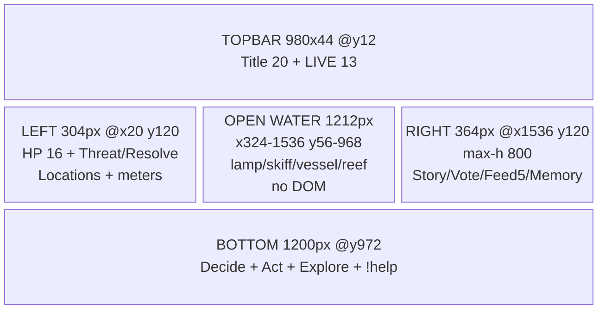

# T4B — Landscape Wireframe (1920×1080, exact)

> Design/spec only. Reference output px @1920×1080 (`1 ref px = 1 output px` native).
> At 1280×720, `effective = ref × 0.667`. No code/CSS/Phaser changes made.

---

## 1. Region map (output px)

```
┌────────────────────────────────────────────────────────────────────────────────┐
│ y12 ┌─ TOPBAR x470-1450 (w980 h44, centered, pill) ─────────────────────────┐ │
│     │ TIDEBOUND 20 · ●LIVE 13 · ARC I · CHAPTER I 13 · STREAM n pill 11      │ │
│     └────────────────────────────────────────────────────────────────────────┘ │
│                                                                                │
│  x20w304              OPEN WATER x324-1536 (w1212)              x1536w364      │
│ ┌─ LEFT ────┐  ┌─ WORLD (canvas, full-bleed behind HUD) ────┐  ┌─ RIGHT ───┐  │
│ │y120       │  │ lamp 300,392 · tower 245,430 · beam→1150    │  │y120     │  │
│ │HP chips   │  │ skiff 720,800 · lantern 778,760             │  │STORY    │  │
│ │Keeper/Keep│  │ reef 850-1250/850 · label y962              │  │23+14    │  │
│ │/Vessel 16 │  │ vessel 1420,780 · bar→x340* · moon 1560,175 │  │~120px   │  │
│ │Threat /100│  │ chapel 525,706 · keep bar x340 y592* (MOVED)│  │VOTE     │  │
│ │Resolve    │  │ open corridor y56-968, no DOM                │  │dorm48 / │  │
│ │Supplies   │  │                                              │  │open260/ │  │
│ │Locations  │  │  *T4C move: keep bar x205→x340 (see §3)      │  │closed140│  │
│ │Meters ×2  │  │                                              │  │FEED 5   │  │
│ │14/12/13px │  │                                              │  │×44=220 │  │
│ └───────────┘  └──────────────────────────────────────────────┘  │DEEDS 2  │  │
│                                                                 │RECAP ~70│  │
│                                                                 └─────────┘  │
│ y972 ┌─ BOTTOM x360-1560 (w1200, centered, pill) ──────────────────────────┐ │
│      │ Decide: !voteA !voteB · Act: !strike(3s) !mend(5s) !shield(8s) … 14   │ │
│      │ New here? Type !help · votes count only while assembly calls one 13  │ │
│      └──────────────────────────────────────────────────────────────────────┘ │
│                y70 ┌─ EVENT BANNER x560-1360 (w800, temp 4-6s) ─┐              │
│                    │ Title 20 → sub 15 (assertive once)          │              │
└────────────────────────────────────────────────────────────────────────────────┘
PAUSED pill: centered y104, 16 bold gold (replaces LIVE dot state when paused).
```



---

## 2. Exact bounding regions

| Region | x–y–w–h (output px) | Padding / gaps | Content + type |
|---|---|---|---|
| Topbar | x470 w980, y12 h44, centered, `pad 6 20`, pill `r20` | `gap 12` between title/LIVE/sub | `TIDEBOUND` 20 bold 0.24em gold · `● LIVE` 13 bold (red dot 8px + pulse, static reduced-motion) · `ARC I · CHAPTER I` 13 · `STREAM n` 11 pill. `nowrap`, ellipsis beyond 980. |
| Left rail | x20 w304, y120, `gap 10`, panels `pad 10 14 r10` | Panel stack, no scroll | HP chips `Keeper 34/40 · Keep 28/30 · Vessel 46/60` 16 tabular (NEW primary numerics) → Threat 15 + sentence 13 + 8px bar → Resolve 15 + sentence 13 + bar → `◆ Supplies` 15 → locations 14 (`●/◐/○` + CONDITION) → meters 14/12/13 + 8px bars. |
| Right rail | x1536 w364, y120, `max-h:800`, `overflow:hidden`, `gap 10`, panels `pad 10 14 r10` | Story 120 / vote dorm48·open260·closed140 / feed 220 / deeds 44 / recap 70 / gaps 40 → 550–740 total | Story kicker 11 + moment 23/1.32 (2-line clamp) + Next 14 → vex→banner (temp) → vote (prompt 22, opt 16/key14/cmd15/n16, tally 14, verdict 16) → feed 5×44 (name 18/desc 16) → deeds 2×22 13px → recap 13px (1 + place/tension, `max-h:88`) |
| Bottom strip | x360 w1200, y972–1068 (`bottom:12`), centered, `pad 10 18 r10` | Groups wrap, `gap 2 12` | `Decide: !voteA !voteB` first → `Act:` 5 cmds → `Explore:` 3 cmds (cmd 14 teal-bold + gloss + `(Ns)` 13 dim) → help 13 centered. `white-space:nowrap` per group; strip wraps to ≤3 rows. |
| Event banner | x560 w800, y70 h~60, centered, `pad 10 18 r10`, gold border | Replaces old (queue 1), 4–6 s | Title 20 bold + sub 15 dim. `role=status aria-live=assertive` on insert, then `polite`. Transform-only entry. |
| Open water | x324–1536 (w1212), y56–968 | No DOM | Canvas world (lamp/beam/skiff/reef/vessel/chapel/moon). Rails `pointer-events:none`, panels `rgba(10,6,24,.78)` so sea shows through. |
| Paused | centered, y104, `pad 6 22 r8` | — | `PAUSED` 16 bold on gold. |

Height proof (right rail, worst case open + vex): 120 + 48 + 260 + 220 + 44 + 70 + 40 gaps = 802px → budget `max-h:800` holds by collapsing deeds to 1 when vex present (locked rule: vex and deeds never both full — vex temp wins).

---

## 3. Cinderholm overlap — resolved

- **Problem:** keep canvas bar `x205 y592 w190` + `CINDERHOLM` label (`GameScene.ts:190-193`) sit under left rail (rail spans x20–324) — ~87px underlap. Legible today only via translucency.
- **T4B decision (for T4C):** move the world-anchored keep bar + label **east to `x340 y592`** in the landscape layout config (Phaser position change, no art change), keeping `w190 h20` and 22px HP / 26px label sizes. Rationale: rail stays at w304 (world status needs ≥14px); canvas has open water at x324–500 (between keep island and chapel) — bar lands on sea with no entity collision (chapel x470–560 y726+ is below; beam passes above at y~380–484). Hero bar (`628,926`), vessel bar (`1280,566`), reef label (`y962`) already clear of rails/strip — unchanged.
- **Redundancy fix:** DOM HP chips become the primary numeric source; canvas bars stay as world-anchored reinforcement (no prose duplication — chips `34/40`, canvas `Keep 28/30`, same numbers, different surfaces, accepted).
- Interim (pre-T4C): translucency suffices; document as known overlap, not a blocker.

---

## 4. Safe areas / OBS / density / stacking

- OBS source `1920×1080`, transparent, no extra styling. Action-safe 40px (`40–1880 × 40–1040`); title-safe 80px for headline/prompt. Bottom `bottom:12` is OBS-safe (no player chrome in source); browser preview note +24px clearance.
- Density: right rail ~38–44 chars/line at 16px; feed desc 2-line clamp; names 1-line ellipsis ~18–22 chars. Left rail tabular numbers (`font-variant-numeric:tabular-nums`).
- Stacking: canvas z0 → world bars/labels → HUD panels (translucent) → event banner → paused pill → topbar. HUD `pointer-events:none` throughout.
- 720p note: whole bitmap `0.667×`; rail becomes 243px — text wraps, height grows; operator guidance (no code): prefer 1080p source; if 720p, feed 4 + deeds 1. T4F verifies at viewing distance.
