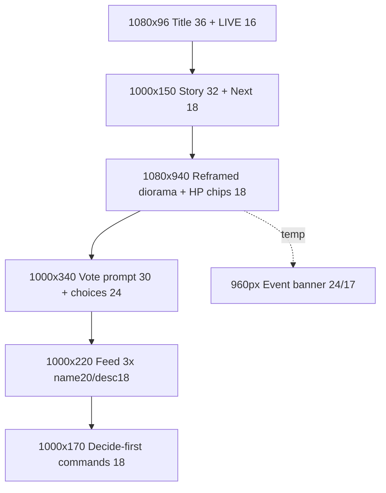

# T4B — Vertical Wireframe (1080×1920, reframed — not scaled/cropped)

> Design/spec only. Reference output px @1080×1920 (`1 ref px = 1 output px` native portrait source).
> At 720×1280, `effective = ref × 0.667`. Single-Phaser-scene reframe (T4A Option 2, locked).
> No code/Phaser/asset changes made.

---

## 1. Region map (output px)

```
┌──────────────────────┐
│ y0 h96               │
│ TOP x0 w1080         │  TIDEBOUND 36 · ●LIVE 16
│ Title + LIVE         │  ARC I · CHAPTER I 16 · STREAM pill 13
├──────────────────────┤
│ y96 h~150            │
│ STORY x40 w1000      │  Story now kicker 13 · moment 32 (2-line clamp)
│                      │  Next · objective 18 gold (1 line)
│                      │  First-join premise 16 (until first deed)
├──────────────────────┤
│ y250 h~940           │
│ WORLD x0 w1080       │  Reframed diorama (NOT scaled landscape):
│  HP chips overlay    │   lighthouse upper-third · skiff mid (focus)
│  Keeper/Keep/Vessel  │   reef lower-mid · vessel mid-right in
│  18 tabular + threat │   moon recentered · beam shortened
│  sentence 16         │  Canvas labels 28-34px · bursts re-anchored
├──────────────────────┤
│ y1190 h~340 (80 dorm)│
│ VOTE x40 w1000       │  Assembly · open/dormant/decided
│                      │  prompt 30 · opt 24/key18/cmd20/n22
│                      │  tally 18 · verdict 22 · clock 10px bar
├──────────────────────┤
│ y1530 h~220          │
│ FEED x40 w1000       │  The tide turns · 3 rows (name 20/desc 18)
│  3 attributed deeds  │  +N more acts (non-interactive)
├──────────────────────┤
│ y1750 h~170          │
│ COMMANDS x40 w1000   │  Decide: !voteA !voteB 18 (first)
│  thumb-safe zone     │  Act / Explore 18 + (Ns) · !help 15
└──────────────────────┘
y210 ┌─ EVENT BANNER x60 w960 (temp 4-6s, over world top) ─┐
     │ Title 24 → sub 17 (assertive once)                  │
Memory (deeds/recap/vex card): HIDDEN in portrait (console retains).
```



---

## 2. Exact bounding regions

| Region | x–y–w–h (output px) | Type / padding | Content |
|---|---|---|---|
| Top identity | x0 w1080, y0 h96, `pad 12 40` | Title 36 bold 0.2em gold, LIVE 16, sub 16/13 | `TIDEBOUND · ● LIVE` + `ARC I · CHAPTER I · STREAM n`. `nowrap` title; sub wraps 1 line. |
| Story | x40 w1000, y96 h~150, `gap 6` | Kicker 13, moment 32/1.3 (2-line clamp), Next 18 | `storyLog[0]` + `Next · objective`. Premise 16 until first deed (copy only). `role=status aria-live=polite`. |
| World | x0 w1080, y250 h~940 | Canvas 28–34px labels; DOM chips 18 tabular on `.82` scrim | Diorama reframe (see §3) + `Keeper 34/40 · Keep 28/30 · Vessel 46/60` chips + threat sentence 16. No deeds/recap/vex card here. |
| Vote | x40 w1000, y1190 h~340 open / 80 dormant / ~180 closed, panels `pad 14 18 r12` | Kicker 13, prompt 30/1.25 (2-line), opt 24 / key 18 (36px box) / cmd 20 / n 22 tabular, tally 18, verdict 22, clock 10px | Same `voteModel` as landscape. Dormant collapse (+260px) gives world 1200 or feed 4 (locked: world grows first). |
| Feed | x40 w1000, y1530 h~220 | Name 20 bold / desc 18, 2-line clamp | 3 `ViewerFeedItem` rows (~70px each). `+N more acts` muted line when overflow. Batch `polite`. |
| Commands | x40 w1000, y1750 h~170 (thumb-safe) | Group 18, cmd 18 teal-bold, help 15 | `Decide: !voteA !voteB` → `Act: !strike(3s)…` → `Explore: …` → `New here? Type !help…`. No critical HUD below y1700 except these hints. |
| Event banner | x60 w960, y210 h~80 (over world top) | Title 24 bold + sub 17 | Temp 4–6 s, queue 1, `assertive` once. Never duplicates verdict/feed. |
| Safe areas | sides 48 (`48–1032`), top 120, thumb-safe bottom 220 (y1700–1920) | — | No critical text outside action-safe; platform chat overlaps bottom 220 in simulcast preview (OBS source itself has no player chrome). |

Height proof (vote open): 96 + 150 + 940 + 340 + 220 + 170 = 1916px + 4px gaps → fits 1920. Dormant: −260 → 1656px, surplus to world (preferred) — world grows to ~1200px tall, feed stays 3.

---

## 3. Reframe strategy (single scene, locked — T4C implements)

One `GameScene` + world state + Keeper/Vessel assets; format-selected portrait layout config. No second `Game`, no forked scene, no art change.

| World element | Landscape anchor | Portrait treatment (T4C config) |
|---|---|---|
| Sky/stars/clouds | full `0–660`, moon `1560,175` | Keep gradient + procedural stars; moon recentered `x~800 y180`; storm bands recentered |
| Sea/waves | `0,660–1080` | Keep; narrow frame still reads as sea; `chop` rule unchanged |
| Cinderholm + lighthouse | lamp `300,392`, tower `245,430`, keep `120,640`, beam `→1150` | Upper-third stack; beam shortened inward (`→~800`) so it stays in frame; keep bar/label ride with island (re-anchored, 28–34px labels) |
| Keeper skiff (focus) | container `720,800`, lantern `778,760` | Mid-frame hero; largest scale emphasis; `WARD UP` + `Keeper hp` labels 28–30px; `healHero` burst re-anchored to new skiff pos |
| Pale reef | posts `850–1250`, label `y962` | Lower-mid; keep ≥3 posts + label (progress signal); `discovery` burst re-anchored |
| Gloam Vessel | container `1420,780`, bar `1280,566` | Mid-right pulled inward to frame edge; hull/masts/HP/label 30–34px stay readable; `hitEnemy` burst + shake re-anchored |
| Chapel | `525,706` | Keep if frame allows; first to soften (documented secondary loss) |
| Bursts/effects | `1420,740 / 720,820 / 300,560 / reef / 960,420` | All five re-anchored to portrait positions; shake/flash magnitudes preserved (no per-frame scroll; fixed arrangement preferred over follow) |

What is hidden / resized: deeds + recap + standalone vex card hidden (banner carries vex); all HUD type resized per portrait scale (§4 of master spec); canvas labels up 28–34px; vote key box 36px.

---

## 4. Rules (locked)

- Format-selected composition, not media queries: creator picks 16:9 vs 9:16 per broadcast (T4E toggle = preview/source switch, never world mutation).
- Portrait DOM is a separate stacked structure reusing `headerModel`/`voteModel`/feed/`threatModel`; no new engine fields.
- Reduced-motion parity: instant swaps, static LIVE dot, no shake/flash/burst.
- Performance: ~25 DOM nodes, transform-only entry, one-time reposition per format switch (not per tick), particle/tween budgets unchanged.
