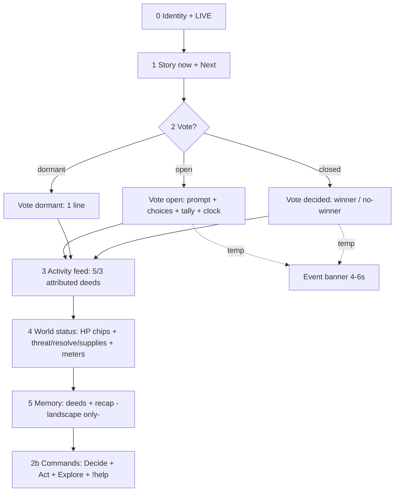

# T4B — Viewer HUD Visual Design Spec (Master)

> Design/specification only. No source, CSS/HTML, Phaser, asset, engine, or Git changes made.
> Reads the four T4A specs as input and locks decisions for T4C (portrait camera) and T4D (feed + storytelling).
> Approved: 16:9 + 9:16, all accepted viewer commands with attribution, reframed (not cropped) portrait,
> hierarchy Story → Vote → Activity → World Status → Memory.
> Keeper/Vessel artwork unchanged. No image generation.

Related:

- `docs/t4b-landscape-wireframe.md` — exact 1920×1080 region map (TASK D)
- `docs/t4b-vertical-wireframe.md` — exact 1080×1920 region map (TASK E)
- `docs/t4b-typography-and-motion-spec.md` — exact type scales + motion (TASK C + motion)
- T4A inputs: `t4a-viewer-experience-audit.md`, `t4a-landscape-layout-spec.md`,
  `t4a-vertical-layout-spec.md`, `t4a-action-feed-spec.md`

---

## 1. Information architecture (TASK A — locked)

Order is fixed. Priority = vertical position + type size + border emphasis, not color alone.

| # | Region | Exact content | Priority / behavior |
|---|---|---|---|
| 0 | Identity + LIVE | `TIDEBOUND` + `● LIVE` + `ARC I · CHAPTER I · STREAM n` (subline). Saga (`The Cantor's Siege`) stays out of HUD (kept in console/world memory). | Persistent, quiet top. Never competes with story. `PAUSED` pill replaces `LIVE` dot state when paused (existing `hud.ts:157` pattern). |
| 1 | Story | Kicker `Story now · ACTION/CONSEQUENCE/MOMENT` + moment line (`storyLog[0]`, max 2 lines) + `Next · <objective>` (1 line, gold). First-join premise line (copy only, no engine): `A lantern-crew holds the drowned light against the Gloam.` shown until first deed, then replaced by `Next`. | L1 — strongest surface. Left gold border. `role=status aria-live=polite`. |
| 2 | Active vote | Dormant: `Assembly — not called. Routes and burnings are decided here.` (1 line). Open: `Assembly · open` + `What are we deciding?` + prompt (max 2 lines) + options A/B(/C — see §8) each `key + label + Leading? + !voteX + count` + command-clock bar + `N voice(s) · closes after M (K left)` + `closing soon` (≤5). Closed: `Assembly · decided` + `The assembly chose X (reason)` / `No winner — the tide stays its course (reason)`. | L2 — strongest **temporary** focus when open (gold border promotion). Dormant collapses to 1–2 lines. Verdict is the single verdict surface. `role=status aria-live=polite` only when open/closed transition; dormant has no live role. |
| 3 | Viewer activity feed | `ViewerFeedItem[]` newest-first, landscape 5 / portrait 3 (see §2). Header kicker `The tide turns · action becomes consequence`. Empty: `Awaiting the first act…`. Overflow: `+N more acts` (non-interactive). | L3 — persistent HUD, never a scrolling log. `max-height + overflow:hidden` so gameplay stays open. Batch `aria-live=polite` (1 announcement / 1.5 s window). |
| 4 | World status | DOM HP chips (NEW, presenter-joined): `Keeper 34/40 · Keep 28/30 · Vessel 46/60` (1 line, tabular). Then `Threat n/100 + tone sentence` + 8px bar, `Resolve n + sentence` + bar, `◆ Supplies n`, locations `●/◐/○ NAME — CONDITION · note`, meters `Charting the Pale n/5` + `Beacon Oil n/5` (bar + status + 1-line hint). Canvas bars stay world-anchored (see landscape wireframe for overlap fix). | L4 — left rail (landscape) / scrim chips over world top (portrait). Numbers are DOM text (not prose parse); bars are `progressbar`. |
| 5 | Persistent memory | `The world remembers` — deeds (landscape 2, portrait hidden) + `Previously…` recap (landscape 1 + place/tension, portrait hidden). Vex state merges into event banner (not a separate persistent card). | L5 — quiet, smallest. Never re-announces. Portrait hides to fund vote/feed (console retains full memory). |
| 2b | Commands | Grouped: `Decide: !voteA !voteB` first, then `Act: !strike !mend !shield !tribute !defy (+cooldown s)`, `Explore: !scout !ring !hide (+cooldown s)`, `New here? Type !help · votes count only while the assembly calls one`. | Persistent bottom (landscape) / thumb-safe stack (portrait). Presentation-only cooldown hints from `COMMANDS.cooldownMs`. |
| T | Event banner (temp) | One banner at a time, 4–6 s, auto-dismiss, `assertive` once then `polite`. Sources in §5. Never duplicates vote verdict or feed line verbatim. | Temporary overlay above world, below identity. Transform-only entry. |

Dedup rules (locked):

- One verdict surface (vote card). Feed never repeats verdict text.
- One feed surface. Story line never copies a feed line verbatim.
- Deeds appear once (memory). Event banner never persists.
- Delivery status (sent/failed/retry) is creator-only, never viewer.



---

## 2. Action feed design (TASK B — locked, detail in T4A feed spec)

### 2.1 `ViewerFeedItem` presentation schema (final)

```ts
interface ViewerFeedItem {
  id: string;       // GameResult.eventId — dedupe key (SSE replay + queue.seen safe)
  actor: string;    // display name | "A watcher" (missing) | "Someone" (paid only); never actorId
  verb: string;     // struck | restored | scouted | protected | sounded | doused | honored | defied | voted | called | sent | drew | tolled | asked
  target: string;   // Gloam Vessel | Keeper's crew | lighthouse | Pale Reaches | drowned bell | lantern | faced faction | assembly option A/B | supply convoy | Herald | the Bell
  outcome: string;  // enemy health decreased | Keeper +12 | ward up 12s | counted | … (plain words, no internal ids)
  delta?: string;   // 46/60 (−7) | 34/40 (+12) | threat 70 (+8) — presenter-joined from world/SIM, never parsed prose at render
  kind: "action" | "consequence" | "moment";  // existing classifyMoment
  action: GameResult["action"];               // existing machine signal (styling + burst join)
  at: number;       // receivedAt ms (YT publishedAt / sim now()); fallback arrival order
  status: "applied" | "cooldown" | "rejected-effect";
}
```

Never in item or DOM attrs: `actorId`, `amount`, `currency`, `platformEventId`, raw chat text, internal flags/ids/counters/opcodes, payer identity.

### 2.2 Canonical entries (every accepted command has one)

| Command → `action` | Rendered example | Status |
|---|---|---|
| `!strike` → `attack` | **Kaushal** struck the Gloam Vessel — enemy health decreased (46/60). | applied |
| `!mend` → `heal` | **ViewerTwo** restored the Keeper's crew — Keeper 34/40 (+12). | applied |
| `!scout` → `search` | **ViewerFour** scouted the Pale Reaches — charts 3/5. | applied (`already charted` if duplicate) |
| `!shield` → `shield` | **ViewerThree** protected the lighthouse — ward up 12s. | applied |
| `!ring` → `ring` | **Kai** sounded the drowned bell — the Gloam presses (threat 70). | applied (harm tint + text, not color alone) |
| `!hide` → `hide` | **Rho-watch** doused the lantern — threat 62 (−6) · resolve −5. | applied |
| `!tribute` → `tribute`/`rejected` | **Ash** honored the Ashen Choir — standing +5 (5 supplies). / needs 5 supplies (muted). | applied / rejected-effect (still visible) |
| `!defy` → `defy`/`rejected` | **Ash** defied the Ashen Choir — standing −5 · threat +4. | applied / rejected-effect |
| `!voteA/B` → ballot | **Rin** voted — counted for the second path (12 voices). | applied (tally from `voteModel`; result itself is inert `rejected` by design) |
| `!help` → `help` | **Sam** asked — showed command list. | applied, low-priority (first to collapse in bursts) |
| paid → `paid_strike/supply/elite/story` | **Someone** called the storm — the Vessel reels (31/60). / sent supply convoy / drew Herald's Attention / tolled the Bell. | applied, fiction titles only (`catalystModel`) |
| `cooldown` | **Kaushal** — wait ~3s, ward rekindling. (muted, not a deed) | cooldown |
| `duplicate`, `rejected+world` (tick/ledger) | suppressed on viewer feed | never render |

Anonymous: blank `actorName` → `A watcher`. Paid always `Someone`. Never `yt:<…>`, never empty, never invented.

### 2.3 Compact layouts

Landscape row (364px rail, 2 lines max):

```
[Name 18 bold, 1-line ellipsis] verb target — outcome (delta)
  Kaushal struck the Gloam Vessel — enemy health decreased (46/60).
```

- Line 1: name (gold-ink, tabular numbers in delta only). Line 2 (wrap): `verb target — outcome (delta)` in 16px dim-ink. Kind chip dropped in T4B (verb carries meaning; chip was 11px illegible at 720p). Harm verbs (`sounded/defied`) get rose `· harm` text suffix; aid verbs get no extra chrome.
- Row height ~44px; 5 rows = 220px.

Portrait row (1000px stack, 2 lines max):

```
[Name 20 bold] verb target — outcome (delta)
```

- Same structure at 20/18px; 3 rows = ~210px. Names to ~24 chars before ellipsis.

### 2.4 Overflow, entry, truncation, bursts, a11y

- Ordering newest-first, queue order; cross-stream no global clock (honest).
- Visible N: 5 landscape / 3 portrait. History ephemeral (full history stays in console Activity).
- Entry: transform-only `translateY(6px)+fade 160ms`; reduced-motion → instant (see motion spec).
- Live region: one batch `aria-live=polite` announcement per 1.5 s window (`aria-atomic=false`), not per item.
- Duplicates: `id` dedupe; `duplicate` results suppressed.
- Bursts: `>3 same-verb per 1.5 s` collapses to `Kaushal + 4 others struck the Vessel — enemy reels (…)` (presenter aggregation, no engine change). `paid_story/elite` never merge. `!help` collapses first.
- Long names: 1-line ellipsis (~18–22 chars landscape / ~24 portrait); full name in `aria-label` + `title`; codepoint-aware; `overflow-wrap:anywhere`.
- Desc wrap max 2 lines (`line-clamp:2`); contrast on `≥.78` scrim; keyboard N/A (overlay `pointer-events:none`).

---

## 3. Typography (TASK C — decisions locked, values in motion spec)

Reference scale authored at `1920×1080 landscape` and `1080×1920 portrait` respectively
(`1 reference-CSS px = 1 output px` at native source). Other sizes are whole-bitmap OBS scales
(`effective = reference × outputWidth / referenceWidth`); portrait is a separate composition, never a scaled landscape.

Locked output-px values (see `t4b-typography-and-motion-spec.md` for full tables):

- Landscape @1080p: title 20 · LIVE 13 · story 23 · vote prompt 22 · choices 16 / cmd 15 / count 16 · feed name 18 / desc 16 · HP 16 tabular · commands 14 / help 13 · kicker 11 (decorative only).
- Portrait @1080×1920: title 36 · LIVE 16 · story 32 · vote prompt 30 · choices 24 / cmd 20 / count 22 · feed name 20 / desc 18 · HP chips 18 tabular · commands 18 / help 15 · kicker 12–13.
- At 720p landscape (`0.667×`) and 720×1280 portrait (`0.667× of portrait`): headline/prompt/verdict hold; 11px kickers decorative-only (accepted).
- Line rules: story 2-line clamp, prompt 2-line clamp, feed desc 2-line clamp, names 1-line ellipsis, vote labels wrap.

---

## 4. Landscape (TASK D — locked, map in landscape wireframe)

- Regions (output px @1920×1080): topbar `470–1450×12–56`; left rail `20–324×120+` (w304); right rail `1536–1900×120–920` (w364, `max-h:800`); bottom strip `360–1560×972–1068` (w1200); event banner `560–1360×70–130` (w800, temp); open-water corridor `324–1536` preserved.
- **Cinderholm overlap resolved:** keep canvas bar/label (`x205 y592`, `GameScene.ts:190-193`) underlaps left rail (to x324) by ~87px. T4B decision: **move the world-anchored keep bar + `CINDERHOLM` label east in T4C portrait/landscape layout config to `x340 y592`** (Phaser layout-config change, no art change), and add the DOM HP chips line as the primary numeric source so canvas/rail no longer compete. Until T4C lands, translucency keeps it legible (accepted interim). No rail narrowing (would squeeze world status below 14px minimum).
- Safe areas: action-safe 40px, title-safe 80px, bottom clears OBS chrome at `bottom:12` (browser preview note +24px).
- Density: right rail budget ~550–740px in all vote phases (story 120 + vote dormant 48 / open 260 / closed 140 + feed 220 + deeds 44 + recap 70 + gaps) — fits `max-h:800` with no clip at 1080p; 720p guidance: feed 4 + deeds 1.

---

## 5. Portrait (TASK E — locked, map in vertical wireframe)

Single-Phaser-scene reframe (T4A Option 2, preserved): one `GameScene` + world state + assets, format-selected portrait layout config (repositioned containers, shortened beam, recentered moon, re-anchored labels/bursts, enlarged canvas labels 28–34px, separate stacked DOM). No second `Game` instance, no forked scene, no Keeper/Vessel change.

| Element | Portrait treatment |
|---|---|
| Visible | Identity+LIVE, story + Next, reframed world + HP chips, vote card, feed 3, Decide-first commands, event banner |
| Hidden | Deeds, recap, vex card (vex merges into banner); chapel softens first if frame-tight (documented secondary loss) |
| Repositioned | Lighthouse upper-third, skiff mid (signature focus), reef lower-mid, vessel mid-right pulled inward, moon recentered, all five burst points re-anchored |
| Resized | All portrait type per §3 (title 36 → help 15); canvas labels 28–34px; vote key 36px box |

Stack (1080×1920): identity 96 + story 150 + world 940 + vote ~340 (80 dormant) + feed 220 + commands 170 = 1916px. Dormant collapse frees 260px to world/feed. Thumb-safe 220px reserved; action-safe 48px sides.

---

## 6. Event banners (TASK F — locked, engine semantics only)

One at a time, 4–6 s, auto-dismiss, transform-only entry, `assertive` once. Copy is presentation-only; triggers are existing `visual.*` + `voteModel` + `storyMessages`. Never duplicates vote verdict / feed verbatim.

| # | Banner | Trigger (existing signal) | Title → sub |
|---|---|---|---|
| 1 | Enemy arrival | `visual.spawnWave` (non-elite) | `The Gloam stirs` → `a vessel answers the deep` |
| 2 | Elite arrival (Herald) | `visual.spawnElite` | `Herald's Attention` → `an elite vessel answers — hold the light` |
| 3 | Major hit (player) | `visual.hitEnemy` with kill or `paid_strike` | `A telling blow` → `the Vessel reels (HP n/m)` |
| 4 | Final blow / repelled | enemy `hp<=0` (`sunk` in `syncWorld`) | `Repelled` → `the Vessel sinks — the light holds` |
| 5 | Keeper healing | `visual.healHero` | `The crew breathes` → `Keeper n/m (+12)` |
| 6 | Lighthouse shield | `visual.shieldKeep` | `Ward up` → `the beacon holds 12s` |
| 7 | Wave progression | wave counter advance (existing story flag) | `The tide turns` → `<storyMessages[0] short>` |
| 8 | Vote opening | `voteModel.phase open` transition | `The assembly is called` → `<prompt> · type !voteA / !voteB` |
| 9 | Vote result | `voteModel.phase closed` transition | `The assembly has spoken` → `chose X` / `no winner — the tide stays its course` |
| 10 | Major story beat | `visual.majorStory` | `The story turns` → `<storyMessages[0] short, ≤90 chars>` |

Rules: queue depth 1 (new banner replaces old, no stacking); no banner for `!help`, `cooldown`, `duplicate`, dormant vote, meter dormant ticks; reduced-motion → instant swap, no shake/flash (fixes `playResult` reduced-path burst carryover noted in T4A §7).

---

## 7. LIVE + participation (TASK G — locked)

- **LIVE lockup:** `TIDEBOUND` 20/36 bold 0.2em gold + `● LIVE` 13/16 (red dot + gold `LIVE`, CSS pulse, static under reduced-motion) + subline `ARC I · CHAPTER I · STREAM n` 13/16 + 11/13 pill. `PAUSED` pill swaps dot state (existing pattern). No YouTube connection state on viewer HUD (console-only by design).
- **Command instructions (bottom / thumb-safe):** `Decide:` first (vote priority), then `Act:` / `Explore:` groups with `!cmd` teal-bold + 1-word gloss + `(Ns)` cooldown: e.g. `Act: !strike Strike (3s) · !mend Mend (5s) · !shield Ward (8s) · !tribute Honor (10s) · !defy Defy (5s)`. `!help` line: `New here? Type !help in chat · votes count only while the assembly calls one`.
- **New-viewer onboarding:** first-join premise (until first deed): `New here? Type !help — the crew answers in the feed below.` + story premise `A lantern-crew holds the drowned light against the Gloam.` Copy only.
- **Vote instructions:** open card shows `type !voteA / !voteB` inline per option (cmd token visible, 15/20px teal-bold) + `N voice(s) · closes after M (K left)` + `closing soon` ≤5. Closed card shows verdict + reason, no commands.
- **Acceptance feedback:** every accepted command appears in the feed within one pump cycle (≤~250 ms + `minGapMs`) as `Name verb target — outcome (delta)`; `cooldown`/`rejected-effect` appear muted (`wait ~Ns` / `needs 5 supplies` / `assembly not called`); transport rejections (invalid/full, never results) stay creator-only. Viewer confirms by finding their name in the feed — no per-user highlight (privacy: no identity tracking on viewer surface).
- **Anti-confusion:** vote clock shows commands-processed, not wall time; paid never advances clock (existing rule, surfaced as tally note only if needed).

---

## 8. Privacy + accessibility (TASK H — locked)

- Public identity: display name or `A watcher` / `Someone` (paid). Never: `actorId`/`yt:<channelId>`, OAuth tokens, `liveChatId`, amounts/currency/payers, raw chat beyond the `!`-token (body never stored/forwarded per mapper), private messages, internal ids/flags/counters/opcodes/template ids.
- Paid rendering: fiction titles only (`Gale Call / Supply Convoy / Herald's Attention / The Bell Tolls`); queue waiting line must mask `paid <amount>` in T4D (presenter fix noted in T4A).
- Raw chat: only the leading `!`-token is mapped; everything else ignored at the sidecar (`mapper.mjs:59-79`) — never render arbitrary untrusted text.
- Reduced motion: HUD `animation/transition:none`; scene skips waves/clouds/tweens/particles, Keeper frozen; banners/feed instant-swap; LIVE dot static; shake/flash/burst suppressed entirely (no single-burst exception).
- Screen reader: DOM story-first; story + open vote `role=status aria-live=polite`; banner `assertive` once; feed batch `polite` (`atomic=false`); clocks/meters/bars `progressbar` with labels/values; full names in `aria-label`, visual ellipsis only.
- Minimum contrast: ink `#f4efe4` / dim `#b9b3c7` / gold `#ffd166` on `rgba(10,6,24,.78+)` panels; portrait scrim raised to `.82` for glare; faint `#8d89a0` help-only, never sole signal. State never color-alone (`●/◐/○` + text, `Leading` + `◆/◇`, `✦`, harm/aid words).
- Touch-safe sizing: viewer overlay non-interactive (`pointer-events:none`, no focusables — correct); creator retry controls ≥44px (existing); portrait type ≥15px for any glanceable hint (no touch targets on viewer surface to size).

---

## 9. Compatibility gap — `!voteC` (TASK J, separate, not implemented)

Observed (T4A §3.3): Kindling vote has 3 options (`content/tidebound.ts:406-416`; display `VOTE_COMMANDS` includes `!voteC`, `tidebound-presentation.ts:208`) but the chat path accepts only `!votea/!voteb`: whitelist (`config.ts:21-22`), YouTube mapper (`client.ts:30-34`), rehearsal `<select>` (`index.html:593-605`), engine vote tokens inert by design (`engine.ts:492-498`). Viewers typing displayed `!voteC` get `rejected: the assembly has not been called` and a ballot-note at best — tally stalls with no warning (`activity.ts:102-132`).

**Recommendation (owner decision required, no code in T4B):**

- Option 1 (engine+transport change, needs approval): add `!votec → idx 2` consistently — `COMMANDS` + `cooldownMs 5000`, `voteOptionIndex`, mapper whitelist, rehearsal option, `commandGuide`, composer `VOTE_COMMANDS` already covers display. Tests: ballot latest-wins idx 2, clock, `!voteC` outside vote → same inert `rejected`, Kindling full-path tally. Risk: expands accepted-command surface (intended) — update feed verb map + Decide row.
- Option 2 (presentation-only, no engine change): constrain Kindling display to 2 options wherever `!voteC` is advertised (prompt/labels stay, third row hidden with `2 paths` note) OR gate Kindling to Route-style 2-option votes until owner approves Option 1. Risk: story compromise (Rho's peal path unvotable) — must be explicit copy, not silent removal.
- **T4B does not implement or silently remove anything.** T4C/T4D must not advertise `!voteC` in Decide rows, vote cards, or portrait stacks until the owner picks Option 1 or 2. T4F regression must cover the `!voteC` matrix (typed → counted vs rejected-muted).

---

## 10. Files (this phase) / Git / Next gate

- Created (design only): `docs/t4b-viewer-hud-design-spec.md` (this file), `docs/t4b-landscape-wireframe.md`, `docs/t4b-vertical-wireframe.md`, `docs/t4b-typography-and-motion-spec.md`.
- No production files changed. No assets generated. No Git staging/commits/pushes/resets/cleaning/stashing (read-only `git status` only; uncommitted work preserved — see Final Report).
- Next gate (T4C): owner signs region maps (both wireframes), type/motion tables, banner copy, LIVE lockup, `!voteC` Option 1 vs 2, Cinderholm bar move (`x205→x340`), memory-hidden-in-portrait. Then T4C portrait camera config + T4D feed/banner implementation (parallel-safe once tokens lock).
